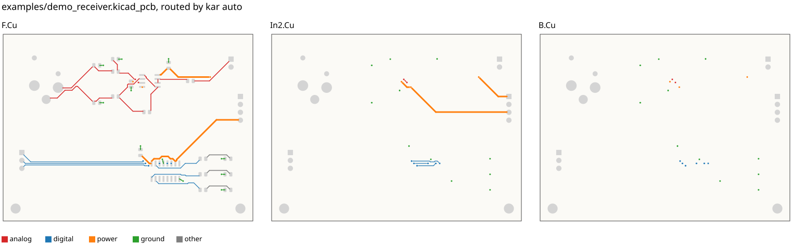

# kicad-audio-router

音響機器の基板を、音響機器の設計者のやり方で配線する KiCad 用の自動配線ツールです。
**状態: 初期版 (0.1.0)** [English](README.md) · [変更履歴](CHANGELOG.md)

汎用の自動配線ツールは、すべての線をつなぐことはできますが、音のことを考えません。アナログ信号をクロックのすぐ横に通したり、バランス信号のホットとコールドを離して引いたり、GND のパッドの近くにビアを置かなかったりします。kicad-audio-router (`kar`) は基板を読み込み、各ネットがアナログ・デジタル・電源・GND のどれに当たるかを判定してから、次の点に気を配って配線します。

- アナログの線はデジタルの銅箔から離す。リレー駆動の線よりクロックの線から、より大きく離す
- バランス信号のホットとコールドは、並べて引く
- 信号線を引く前に、表面実装の GND パッドすべてに、GND のベタへのビアを置く
- 電源の線は決めた太さで引き、細いピンに入る所だけ細くする
- 間隔はネットクラス、穴の周りの間隔、配線禁止エリアを含めて、実際の銅箔の形で確かめる。そのため結果は KiCad の DRC を通る

KiCad に付いている `pcbnew` モジュールの上で動く、純粋な Python です。Java もほかのパッケージも要りません。同じ基板からは同じ結果が出ます (とても混んだパソコンで、時間の上限に達して途中で打ち切った場合を除く)。どのコマンドも結果を JSON で出せるので、スクリプトや AI を使った設計の流れに組み込めます。



*見本基板 (`examples/`): XLR 入力と OPA1612 のバランス受けの横に、74HC595 で LED を点ける回路を置いた基板。74HC595 を動かす線は、アナログの回路の脇を通らないと届かない。配線は約 4 秒。赤がアナログ、青がデジタル、橙が電源。*

## これまでの結果

実際の音響機器の基板 7 枚 (モニターコントローラー、マイクプリ、ファンタム電源、VU メーター、テープサチュレーター) から線をすべて消し、それぞれの設計ルールとネットクラスのまま `kar auto` で一から配線し直しました。元の配線 (手配線または Freerouting) と比べた結果です。点数は `kar report` の値です (0〜100、高いほど良い。[レポートで測るもの](#レポートで測るもの) を参照)。

| 基板 | 層数 | 元の配線 | kar | 時間 |
|---|---|---|---|---|
| モニターコントローラー (約 270 部品、リレー、MUSES72320) | 4 | 52.4 | 85.9 | 143 秒 |
| VU メーター (USB-C) | 2 | 75.7 | 94.1 | 24 秒 |
| テープサチュレーター | 4 | 81.1 | 91.0 | 59 秒 |
| P48 ファンタム電源 | 4 | 82.5 | 85.0 | 23 秒 |
| 2ch マイクプリ (ディスクリート) | 4 | 79.6 | 82.5 | 28 秒 |
| マイクプリ (オペアンプ) | 2 | 78.5 | 86.0 | 81 秒 |
| ファンタム電源ユニット | 2 | 99.3 | 100.0 | 8 秒 |

どの基板も全部の線がつながりました。kar が原因の DRC の問題はありません。残っているのは、部品の外形の重なりや、1 つの部品の中のパッドどうしが近すぎるといった、元の基板にもともとあった問題だけです。

## 導入

kar は KiCad に付いている Python で動かします。`pcbnew` がそこに入っているためです。

```sh
# KiCad に付いている Python
#   macOS:   KPY=/Applications/KiCad/KiCad.app/Contents/Frameworks/Python.framework/Versions/Current/bin/python3
#   Windows: KPY="C:\Program Files\KiCad\9.0\bin\python.exe"
#   Linux:   KPY=python3            (KiCad の pcbnew モジュールが入っているシステムの Python)

$KPY -m pip install git+https://github.com/AsteroidApp-hub/kicad-audio-router
$KPY -m kar doctor --demo           # KiCad を確かめ、見本基板を配線する。すべての行が ok なら使える
```

pip が使えないときは、リポジトリを手元に置き、そのフォルダで `$KPY -m kar ...` を実行してください。

## 使い始め方

1. KiCad で部品を配置して保存する。kar は部品を動かさないので、配置の良し悪しが結果を大きく左右する
2. 配線、確認、レポートを一度に行う

   ```sh
   $KPY -m kar auto board.kicad_pcb -o routed/board.kicad_pcb
   ```

   `routed/board.kicad_pcb` を書き出す。プロジェクトファイルも一緒に書くので、設計ルールもそのまま引き継がれる。`routed/kar_out/` には、DRC の結果、品質レポート、配線の記録を書く
3. 配線した基板を KiCad で開いて、目で見て、DRC をかける。発注の前には必ず行う

## 結果の扱い方

### 確かめる

- kar が置いた線とビアは、`kar: analog`、`kar: digital`、`kar: power`、`kar: ground`、`kar: other` という名前の PCB グループに入る。KiCad でグループをクリックすると、その種類の銅箔をまとめて選べる
- 配線の記録 (`*_route.md` と `.json`) には、ネットごとの長さ・ビアの数・線の太さ・使った層と、普通に引くだけでは済まなかった手順が載る。細かい格子でピンに届かせたネット、ほかの線を押しのけたネットとどかした線、決めた太さより細くした電源ネットが分かる
- 品質レポート (`*_quality.md` と `.json`) には、確かめたい場所の座標 (x、y、層) が載る。アナログの線がデジタルの銅箔にいちばん近づく所と、電源の線がネットクラスの太さより細い所だ
- `kar plot routed/board.kicad_pcb -o board.svg` で、配線を層ごとに、ネットの種類で色分けした図にできる

### 手で直してから引き直す

1. KiCad で、気に入らない所を直す。線を動かす、引き直す、消す、いくつかのネットを自分で引く、などができる
2. kar が置いた線をそのまま残したいときは、その線を `kar: ...` のグループから外す (グループから削除)。自分で引いた線はもともとグループに入っていない
3. `--rip-kar` を付けて、もう一度実行する

   ```sh
   $KPY -m kar auto board_edited.kicad_pcb -o routed_v2/board.kicad_pcb --rip-kar
   $KPY -m kar route board_edited.kicad_pcb -o board_v2.kicad_pcb --rip-kar --nets /SCLK,/SDATA   # このネットだけ
   ```

   kar はまだグループに入っている銅箔を消し、それ以外はその場所のまま残して (押しのけもしない)、残りを配線する。途中まで手で引いたネットは、残っている銅箔から続けて完成させる

## コマンド

| コマンド | すること |
|---|---|
| `auto` | `route` → `ground` → KiCad の DRC (kicad-cli) → `report` を続けて行い、結果を JSON にまとめる |
| `route` | ネットを配線する (`--classes analog,power,digital,other`、`--nets`、`--rip-kar`、`--log フォルダ`) |
| `ground` | ビアから遠い GND パッドにビアを置く、ベタの島を直す、必要ならベタを作る (`--pour F.Cu,B.Cu`) |
| `report` | 配線品質のレポートと点数 |
| `classify` | 各ネットの分類と、その理由 |
| `plot` | 配線の図を SVG で書き出す。層ごとに並べ、ネットの種類で色分けする |
| `doctor` | 使っている KiCad に、kar が使う機能がそろっているかを確かめる (`--demo` を付けると、見本基板の配線も試す) |
| `bench フォルダ` | フォルダ内の基板をすべて一から引き直し、元の配線と比べる |
| `strip` | 線とビアを消す (`--kar-only` を付けると kar が置いたものだけ) |
| `finish` | 任意。kar が引けなかったネットを Freerouting に渡す (DSN/SES)。試験した基板では使う場面が無かった |

オプションは `$KPY -m kar <コマンド> --help` で見られます。

## 配線のしくみ

- 配線に使う層の上に 0.25mm の格子を張り、8 方向とビアで A* 探索をする。基板設定で種類が「電源」の内層は、ベタ用として配線に使わない。格子は細かいピンの位置にそろえる
- 銅箔の近くでは、間隔を正確に確かめる。格子点から、パッドの実際の形・線・ビアまでの距離が、両方のネットクラスの間隔と線の太さの半分を合わせた値以上あるかを見る。次の格子点までのまっすぐな区間の分も見込む
- コスト: アナログの線はデジタルの銅箔の近くを、デジタルの線はアナログの銅箔の近くを通ると割増になる。割増は、デジタル側がどれだけ頻繁に切り替わるか (クロック、データ、ほとんど動かない線) で変える。バランス信号の 2 本目は 1 本目のちょうど隣の位置から外れると割増になる。それでも 2 本が並ばないときは、隣へ引き寄せる力を強めたり、引く順番を逆にしたりして試す
- 順番: GND のビア、細かい格子が必要なピン、バランス信号のペア、アナログ、電源、デジタル、その他
- 引けなかったネットは、ほかの線を割増料金付きで横切って引き、横切られた線を引き直す (押しのけ)。それでも残ったネットについてはそのパッドの周りで格子を半分の細かさにしてもう一度試す
- 狭い所で細くした電源の線は、配線の後で、余裕のある所を太くする。それでも細い区間が残る電源ネットは、ほかの線を押しのけて決めた太さで引き直す。押しのけた線がすべて引き直せたときだけ、その結果を採用する

## レポートで測るもの

| 項目 | 意味 |
|---|---|
| 並走 (coupling) | アナログの銅箔が、同じ層のデジタルの銅箔と 1mm / 3mm 以内 (縁と縁の距離) を走る長さ。デジタル側がどれだけ頻繁に動くかで重みを付ける (クロック 1.0、データ 0.6、ほとんど動かない線 0.15) |
| バランス信号のペア | 2 本それぞれの長さ、長さの差、ピンの付近を除いて並んで走る割合 (ピンの付近はピンの位置で決まる) |
| GND の戻り道 | GND 系ネットの表面実装パッドのうち、同じネットのビアまたはスルーホールパッドから 3mm 以上 (パッドの縁から測る) 離れているもの |
| 電源の太さ | ネットクラスの太さ (ネットクラスが無ければ 0.4mm) より細い電源の線の長さ。細いピンに入る所で細くした部分は数えない |
| アナログのビア | アナログのネットにあるビアの数 |
| 未配線 | KiCad が報告する、つながっていない箇所 |

点数は同じ基板の 2 通りの配線を比べられるように、これらを音響機器向けに重み付けしたものです。比べるための目安で、絶対的な評価ではありません。

## ネットの分類のしかた

1. ルールファイルで名前のパターンを指定したもの
2. 名前で GND・電源と分かるもの (`GND`、`AGND`、`CHASSIS`、`+15V`、`VCC` など)
3. デジタル: 名前 (`SCLK`、`SDA`、`LATCH` など)、デジタル IC (`74*`、`ULN*`、マイコンなど) につながるもの、アナログ IC のデジタル用ピンにつながるもの
4. アナログ: アナログ IC (`OPA*`、`NE5532`、`NJM*`、`MUSES*` など) のピンと、オーディオ端子 (外形名・値・部品番号で判定。XLR、ジャック、`MIC IN`、`OUT L`、`JINL` など) を起点に、抵抗・コンデンサ・トランジスタ・スイッチ・トランス・ボリューム・ダイオード・リレー接点を経由して広げる
5. バランス信号のペア: 名前が `_H`/`_C`、`_P`/`_N`、`+`/`-`、`HOT`/`COLD`、`POS`/`NEG` の違いだけで、同じ種類の部品につながる組

独自の部品番号の付け方 (抵抗の `RGaR`、ダイオードの `DBL`、値が `HFD27` のリレーの `RLL` など) も見分けます。分類は `kar classify` で確かめられ、ルールファイル (`--rules rules.json`。`examples/rules.example.json` と `kar/rules.py` の冒頭を参照) で上書きできます。

## できないこと

- 格子 (0.25mm、必要な所は 0.125mm) の上で配線する。ピン間隔がとても細かい部品 (BGA、0.4mm ピッチの QFN) には、今は対応していない
- 線の長さをそろえる処理、インピーダンスの管理、本格的な差動ペアの同時配線はしない。バランス信号のペアは、ピンの位置が許す所で並べて引く。音響機器の基板にはこれで足りる
- 線は 45 度刻みの直線だけで、円弧やティアドロップは使わない
- 部品は動かさない。ベタは GND のビアと島の修理のほかは手を加えない
- Python で動くので、約 270 部品の混んだ 4 層基板では数分かかる
- 確かめたのは KiCad 10 (macOS) と KiCad 9 (Linux、KiCad 公式の Docker イメージ)。Windows でも動く見込みだが、まだ試していない ([docs/compatibility.md](docs/compatibility.md))。結果を知らせてもらえると助かる

## 開発に参加する

問題が起きる基板を添えた報告が、いちばん役に立ちます。[CONTRIBUTING.md](CONTRIBUTING.md) を見てください。

```sh
python3 tests/test_core.py        # 中心部分のテスト (KiCad 不要)
$KPY tests/test_kicad.py          # 見本基板を通しで配線し、手で直した後の引き直しも試す
$KPY -m kar bench path/to/boards  # 手元の基板をまとめて引き直して、元の配線と比べる
```

## ライセンス

MIT
