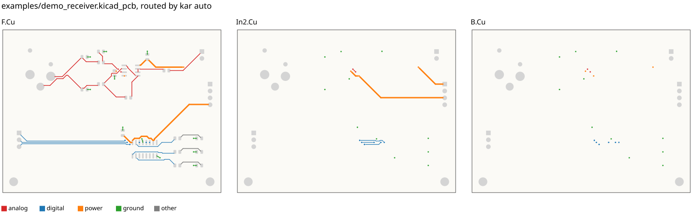

# kicad-audio-router

An autorouter for KiCad that routes audio boards the way an audio designer would.
**Status: early (0.1.0).** [日本語](README.ja.md) · [Changelog](CHANGELOG.md)

General-purpose autorouters connect everything but know nothing about audio: they run analog signals
next to clocks, split balanced pairs, and leave ground pads far from a via. kicad-audio-router (`kar`)
reads your board, works out which nets are analog, digital, power and ground, and routes it with that in mind:

- analog tracks keep away from digital copper, more so from clocks than from relay drivers
- the two sides of a balanced pair run side by side
- every SMD ground pad gets its own via to the ground plane before any signal is routed
- power tracks get their full width, narrowed only where a fine-pitch pin forces it
- clearances are checked against the real copper shapes, with your net classes, hole clearance and
  keep-out areas, so the result passes KiCad's DRC

It is pure Python on top of KiCad's own `pcbnew` module: no Java, no other packages. The same board gives
the same result (unless a time limit cuts a step short on a very busy machine), and every command can report
in JSON for scripts and AI-driven flows.



*The demo board (`examples/`): a balanced line receiver next to a 74HC595 LED driver whose control lines
have to get past the analog path. Routed in about 4 s. Red: analog, blue: digital, orange: power.*

## Results

Seven real audio boards (a monitor controller, mic preamps, phantom supplies, a VU meter and a tape
saturator) were stripped of all tracks and routed from scratch with `kar auto`, each with its own design
rules and net classes, then compared with their original routing (by hand or with Freerouting).
The score is from `kar report` (0–100, higher is better; see [What the report measures](#what-the-report-measures)).

| board | layers | original | kar | time |
|---|---|---|---|---|
| monitor controller (~270 parts, relays, MUSES72320) | 4 | 52.4 | 85.9 | 143 s |
| VU meter (USB-C) | 2 | 75.7 | 94.1 | 24 s |
| tape saturator | 4 | 81.1 | 91.0 | 59 s |
| P48 phantom supply | 4 | 82.5 | 85.0 | 23 s |
| 2-ch mic preamp (discrete) | 4 | 79.6 | 82.5 | 28 s |
| mic preamp (op-amp) | 2 | 78.5 | 86.0 | 81 s |
| phantom power unit | 2 | 99.3 | 100.0 | 8 s |

Every board was fully routed. kar introduced no DRC problems; the only ones left (overlapping courtyards,
pads of one footprint too close together) were already in the original boards.

## Installation

kar runs in the Python that comes with KiCad, because that is where `pcbnew` lives.

```sh
# the Python that comes with KiCad
#   macOS:   KPY=/Applications/KiCad/KiCad.app/Contents/Frameworks/Python.framework/Versions/Current/bin/python3
#   Windows: KPY="C:\Program Files\KiCad\9.0\bin\python.exe"
#   Linux:   KPY=python3            (the system Python that KiCad's pcbnew module is installed for)

$KPY -m pip install git+https://github.com/AsteroidApp-hub/kicad-audio-router
$KPY -m kar doctor --demo           # checks your KiCad and routes the demo board; every line should say ok
```

Without pip, clone the repository and run `$KPY -m kar ...` from its folder.

## Quick start

1. Place the parts in KiCad and save. kar does not move footprints; the placement decides a lot.
2. Route, check and report in one go:

   ```sh
   $KPY -m kar auto board.kicad_pcb -o routed/board.kicad_pcb
   ```

   This writes `routed/board.kicad_pcb` (with the project file, so your rules travel with it) and, in
   `routed/kar_out/`, the DRC result, the quality report and the route log.
3. Open the routed board in KiCad, look at it, run the DRC. Always do this before ordering.

## Working with the result

### Reviewing

- Everything kar places goes into PCB groups named `kar: analog`, `kar: digital`, `kar: power`,
  `kar: ground` and `kar: other`. Click a group in KiCad to select that kind of copper at once.
- The route log (`*_route.md` / `.json`) lists each net's length, vias, widths and layers, and every
  step that needed more than a plain route: pins reached on a finer grid, nets that pushed others aside
  (and which ones they moved), power nets narrowed below their width.
- The quality report (`*_quality.md` / `.json`) gives board coordinates (x, y, layer) for the places to look
  at: where each analog net comes closest to digital copper, and where power tracks are narrower than
  their net class width.
- `kar plot routed/board.kicad_pcb -o board.svg` draws the routing per layer, coloured by net class.

### Fixing things by hand, then re-routing

1. Change what you do not like in KiCad: move or redraw tracks, delete them, route a few nets yourself.
2. To keep a track kar placed exactly as it is, take it out of its `kar: ...` group (Remove from group).
   Tracks you draw yourself are not in a group anyway.
3. Run again with `--rip-kar`:

   ```sh
   $KPY -m kar auto board_edited.kicad_pcb -o routed_v2/board.kicad_pcb --rip-kar
   $KPY -m kar route board_edited.kicad_pcb -o board_v2.kicad_pcb --rip-kar --nets /SCLK,/SDATA   # only these
   ```

   kar removes the copper still in its groups, leaves everything else exactly where it is (it does not
   push it aside), and routes the rest. Nets that you routed part of are completed from that copper.

## Commands

| command | what it does |
|---|---|
| `auto` | `route` → `ground` → KiCad DRC (kicad-cli) → `report`, with a JSON summary |
| `route` | routes the nets (`--classes analog,power,digital,other`, `--nets`, `--rip-kar`, `--log DIR`) |
| `ground` | a via for every ground pad far from one, repair of pour islands, optional pours (`--pour F.Cu,B.Cu`) |
| `report` | routing quality report and score |
| `classify` | how each net was classified, and why |
| `plot` | SVG picture of the routing, one panel per layer, coloured by net class |
| `doctor` | checks that your KiCad offers what kar needs (`--demo` also routes the demo board) |
| `bench DIR` | re-routes every board in a folder from scratch and compares with its original routing |
| `strip` | removes tracks and vias (`--kar-only`: only kar's) |
| `finish` | optional: hands nets kar could not route to Freerouting (DSN/SES); not needed on the test boards |

Run `$KPY -m kar <command> --help` for the options.

## How it routes

- A* search on a 0.25 mm grid over the routing layers, 8 directions plus vias. Inner layers whose type is
  *power* in the board setup are left to planes. The grid is aligned to fine-pitch pads.
- Clearance is checked exactly near copper: from a grid point, the distance to the real pad outline,
  track or via must leave the clearance of both net classes plus half the track width, with an
  allowance for the straight run to the next grid point.
- Costs: analog nets pay for running near digital copper, digital nets for running near analog copper,
  weighted by how often the digital net switches (clock, data, static). The second side of a balanced
  pair pays for leaving the line one track pitch beside the first; if the two still do not run together,
  a stronger pull and the reverse order are tried.
- Order: ground vias, pins that need a finer grid, balanced pairs, analog, power, digital, other.
- A net that does not fit is routed through other tracks at a price, and the tracks it crossed are routed
  again ("push"). What still fails is tried on a grid twice as fine around its pads.
- Power tracks narrowed in tight spots are widened afterwards where there is room; if a power net is
  still narrow, it is routed again at full width by pushing other tracks aside, and kept only if every
  pushed track finds a new way.

## What the report measures

| metric | meaning |
|---|---|
| coupling | analog copper within 1 mm and 3 mm (edge to edge, same layer) of digital copper, weighted by how active the digital net is (clock 1.0, data 0.6, static 0.15) |
| balanced pairs | length of each side, mismatch, and the share routed side by side away from the pins (pin positions decide the rest) |
| ground return | SMD pads of each ground net farther than 3 mm (from the pad edge) from a via or through-hole pad of the same net |
| power width | length of power track narrower than its net class width (0.4 mm without a class); neck-downs into fine-pitch pins are not counted |
| analog vias | vias on analog nets |
| unrouted | unconnected items reported by KiCad |

The score weights these for audio work so that two routings of the same board can be compared.
It is a comparison aid, not an absolute grade.

## How nets are classified

1. explicit patterns in the rules file
2. ground and power by name (`GND`, `AGND`, `CHASSIS`, `+15V`, `VCC`, …)
3. digital by name (`SCLK`, `SDA`, `LATCH`, …), by touching a digital IC (`74*`, `ULN*`, MCUs, …), or a
   digital pin of a mixed-signal IC
4. analog: pins of analog ICs (`OPA*`, `NE5532`, `NJM*`, `MUSES*`, …) and audio connectors (by footprint,
   value or reference: XLR, jack, `MIC IN`, `OUT L`, `JINL`), spread through resistors, capacitors,
   transistors, switches, transformers, pots, diodes and relay contacts
5. balanced pairs: names that differ by `_H`/`_C`, `_P`/`_N`, `+`/`-` or `HOT`/`COLD`, `POS`/`NEG`, and that
   connect to the same kinds of parts

House-style designators (`RGaR` for a resistor, `DBL` for a diode, `RLL` with value `HFD27` for a relay) are
recognised. Check the result with `kar classify` and override anything with a rules file
(`--rules rules.json`; see `examples/rules.example.json` and the top of `kar/rules.py`).

## Limitations

- kar routes on a grid (0.25 mm, 0.125 mm where needed). Very fine-pitch parts (BGAs, 0.4 mm QFNs) are
  out of reach for now.
- No length matching, impedance control or true coupled differential-pair routing: balanced pairs run
  side by side where the pins allow, which is what audio boards need.
- Tracks are straight segments at 45° steps; no arcs or teardrops.
- kar does not move parts or shape copper pours beyond ground vias and island repair.
- It is Python: a dense 4-layer board with ~270 parts takes a few minutes.
- Tested on KiCad 10 on macOS. KiCad 9, Windows and Linux are expected to work and are checked in CI
  ([docs/compatibility.md](docs/compatibility.md)); please report what you find.

## Contributing

Bug reports with a board that shows the problem help most; see [CONTRIBUTING.md](CONTRIBUTING.md).

```sh
python3 tests/test_core.py        # pure-Python tests, no KiCad needed
$KPY tests/test_kicad.py          # demo board end to end, re-route after hand edits
$KPY -m kar bench path/to/boards  # re-route a folder of your boards and compare
```

## License

MIT
